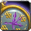

# Auctionator Market Value

A WoW Forever addon that shows how every auction price compares to its market value: the 14-day average from Auctionator's scans and, with TradeSkillMaster, TSM's market value. It works in Auctionator and in Blizzard's Auction House. Needs Auctionator.

## Features

- Tooltips show an item's 14-day average, how many days ago its price was last seen, and how its last price compares.
- TradeSkillMaster support: tooltips also show TSM's market value, how old that data is, and how the last price compares to it, from the TSM addon or, with the addon off, from the TSM desktop app's data.
- Auction lists show each price as a percentage of the average, and deals glow green.
- A Relative column in Auctionator's Shopping and Selling tabs and in Blizzard's auction lists.
- A price you type to sell shows its percentage before you post.
- Similar auctions help you price gear and bags.
- Sale Scan refreshes the prices of everything in your bags with one click.
- A Full Scan button on Auctionator's Shopping tab refreshes every price on the Auction House, with its progress on the button.

## Usage

1. Open the Auction House and click Full Scan in Auctionator's Shopping tab, or Sale Scan in its Selling tab, so prices exist.
2. Hover an item to see its average. A gray percentage rests on fewer than 3 days of prices. With the TradeSkillMaster addon or its desktop app installed, the TSM rows appear on their own.
3. Browse and shop as usual. Green rows are deals. Sort by Relative to find the cheapest listings.
4. Type `/amv`, or pick Auctionator Market Value in the addon menu, to set the Sell Threshold, the Deal Threshold and the Similar Items ranges. `/amv help` lists the commands, `/amv intro` shows the welcome line and the Full Scan tip again.
